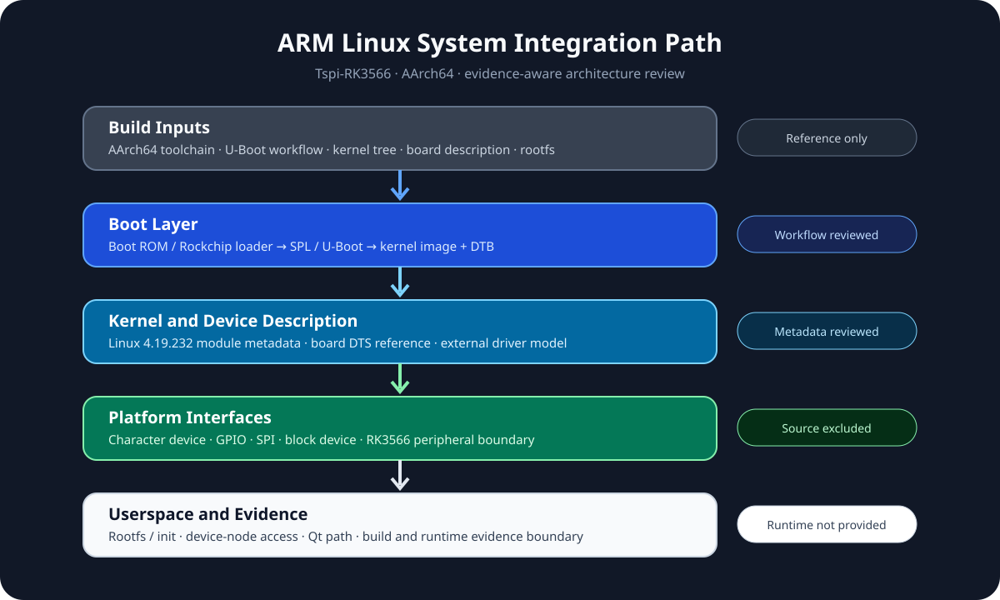

# ARM-Linux-Embedded-Lab

An original Linux device I/O lab with a C11 monitor, a separate PTY device simulator, bounded binary framing, actual `/dev/pts/<N>` communication, automated native tests, AArch64 cross build and QEMU userspace validation. Historical Tspi-RK3566 / RK3566 notes remain architecture references; this Host work is not a board boot or physical UART test.



## What runs

```text
Python simulator process → PTY master → Linux kernel PTY driver
                                      → /dev/pts/<N> → C monitor process
                                      → frame parser → device state and diagnostics
```

The monitor opens the kernel device node nonblocking, configures raw `termios`, uses `poll`, `read` and bounded `write`, sends PING and checks PONG. It detects malformed frames, sequence errors, timeout and master disconnect; all paths close the file descriptor. DATA values are synthetic. The simulator is an independent process, and the integration harness checks process exit codes and retained logs rather than substituting in-memory callbacks.

### Native Linux build and test

On Ubuntu 24.04 with CMake, Ninja, GCC/Clang and Python 3:

```sh
cmake -S . -B build -G Ninja -DCMAKE_BUILD_TYPE=Debug
cmake --build build --parallel
ctest --test-dir build --output-on-failure
```

CTest runs a portable protocol test and four real PTY scenarios: `normal`, `malformed`, `disconnect`, `timeout`. To run one scenario and retain its own logs:

```sh
python3 tests/pty_integration.py --scenario normal --monitor build/device_monitor --simulator tools/pty_device_simulator.py
```

The exact frame format, state machine, syscall behavior and scenario expectations are in [Linux device runtime](docs/linux-device-runtime.md). CI also builds and tests with Clang and application ASan/UBSan. On Windows, only the portable protocol test can run locally; PTY evidence comes from the Ubuntu jobs.

### ARM64 and external module

The [AArch64 toolchain file](cmake/aarch64-linux-gnu.cmake) builds real ARM64 Linux userspace ELF files from Ubuntu cross packages. CI checks `file`/`readelf` and executes the protocol test and PTY monitor under QEMU user mode. Commands and evidence boundaries are in [AArch64 verification](docs/aarch64-build-verification.md).

The original [misc-device module](kernel/lab_echo.c) has a separate Kbuild path. CI attempts a real `.ko` build against installed Ubuntu x86_64 headers and records `file`, `readelf`, `modinfo` and a hash. It is never loaded. See [module boundary](docs/kernel-module-boundary.md).

## Evidence boundary

| Layer | Current implementation |
| --- | --- |
| Linux Host | Real kernel PTY node and C device I/O; exact pass status is in CI |
| AArch64 | Cross-compiled userspace ELF and QEMU userspace execution; exact pass status is in CI |
| Host kernel module | External Kbuild source and CI job; build status requires actual `.ko` evidence |
| RK3566 | Historical Tspi-RK3566, `tspi-rk3566-user-v10-linux.dts` and excluded 4.19.232 module metadata only; no board boot, target driver, Device Tree or hardware verification |

No course driver, vendor BSP/DTS, historical rootfs, toolchain archive, private credential or board artifact is copied into this repository. [Source provenance](docs/source-provenance.md) and [third-party notices](THIRD_PARTY_NOTICES.md) state the reuse limits. The original [boot flow](docs/boot-flow.md), [build environment](docs/build-environment.md), [Device Tree](docs/device-tree.md), [driver model](docs/driver-model.md) and [system architecture](docs/system-architecture.md) remain reference documents. [Verification](docs/verification.md) separates current Host evidence from historical material.

## License

Original userspace code and documentation follow the repository's [MIT license](LICENSE). The original kernel module has an explicit MIT OR GPL-2.0-only declaration. Third-party Linux, compiler and QEMU components retain their own licenses and are not vendored.
